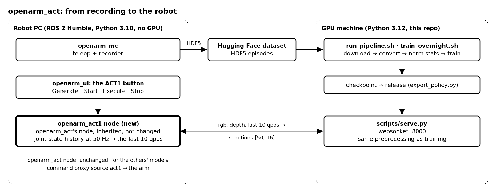
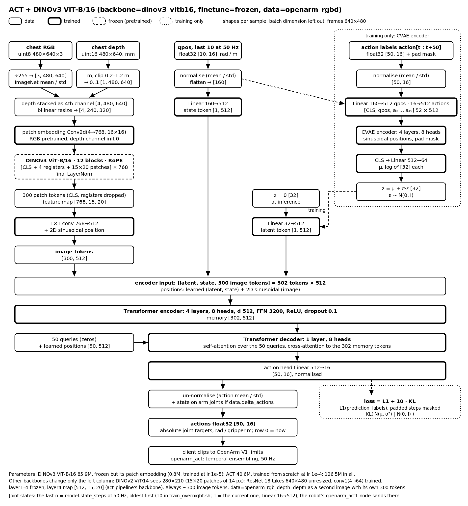
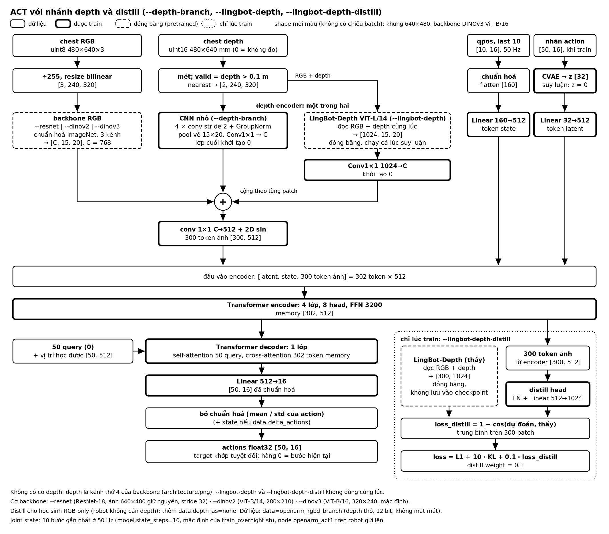

# openarm_act

Train [ACT](https://tonyzhaozh.github.io/aloha/) (Action Chunking with Transformers) on
teleoperation episodes of the **OpenArm V1** bimanual arm, with a choice of vision backbone —
**DINOv3**, **DINOv2** or ACT's own **ResNet** — and serve it to the robot.

- **Input:** one RGB-D image from the chest camera and the 16 joint positions.
- **Output:** the next **50 joint states** (1 s at 50 Hz) for all 16 joints, as absolute targets.
- **One command** goes from the Hugging Face dataset to a trained model.
- Same data, labels, held-out episodes and robot client contract as
  [openarm_smolvla](../openarm_smolvla), [openarm_pizero](../openarm_pizero) and
  [openarm_lingbot](../openarm_lingbot), so the models compare directly.

## Contents

- [What this repository is](#what-this-repository-is)
- [How it works](#how-it-works)
- [Model](#model)
- [Requirements](#requirements)
- [Quick start](#quick-start)
- [Where everything is saved](#where-everything-is-saved)
- [Configuration](#configuration) ([training flags](#training-flags))
- [Step by step](#step-by-step)
- [Evaluation and export](#evaluation-and-export)
- [Serving to the robot](#serving-to-the-robot)
- [Troubleshooting](#troubleshooting)
- [Development](#development)
- [Project layout](#project-layout)

## What this repository is

The OpenArm project trains several robot policies on the same teleoperation data and compares
them on the robot. Each policy lives in its own repository with the same layout:

| Repository | Policy | Size | Prompt |
|---|---|---|---|
| **openarm_act** (this one) | ACT, a CVAE + transformer trained from scratch on top of a pretrained vision backbone | 52M (ResNet-18) – 344M (ViT-L); 126M with the default ViT-B | none |
| openarm_smolvla | SmolVLA, a vision-language-action model fine-tuned from `smolvla_base` | ~450M | task text |
| openarm_pizero | π0 / π0.5 (openpi) | ~3.3B | task text |
| openarm_lingbot | LingBot-VLA 1.0 / 2.0 | 4–6B | task text |

ACT is the smallest and fastest of them, and the one that already runs on the robot:
act_pipeline (OpenArm_MC) trains it with a ResNet-18 that reads a 4-channel RGB-D image. This repository keeps that recipe — the same input, the same labels, the
same 15 % of episodes held out — and asks one question: **does a stronger, self-supervised vision
backbone make ACT better?** DINOv3 (Meta, 2025) and DINOv2 (2023) give much richer image features
than an ImageNet ResNet; `backbone=resnet18` reproduces act_pipeline's backbone as the baseline.

Three machines are involved:



The robot keeps running its existing `openarm_act` node (chunking, temporal ensembling,
smoothing, safety limits); only the policy it loads changes, to a small client that asks this
repository's server for each chunk.

## How it works

**Data.** [openarm_mc](../openarm_mc)'s recorder writes one HDF5 file per episode: chest RGB
(uint8), chest depth (uint16 mm), the 16 joint positions, at 50 Hz.
[convert.py](src/openarm_act_lerobot/convert.py) turns them into a
[LeRobot](https://github.com/huggingface/lerobot) dataset (MP4 video + parquet): the RGB frame,
the depth frame as a gray image (0.2–1.2 m → 0..255, as ACT scales it), the state, and the label
for every frame. [manifests/episodes.yaml](manifests/episodes.yaml) excludes or holds out
episodes; 15 % are held out by a hash of their name, for offline evaluation.

**Network.** LeRobot's ACT, with the backbone swapped in
([modeling_openarm_act.py](src/openarm_act_lerobot/modeling_openarm_act.py),
[backbones.py](src/openarm_act_lerobot/backbones.py)). The default model, with every shape
(thin boxes: data; thick: trained; dashed: frozen; grey: training only):



- The **backbone** turns the image into a grid of tokens: DINOv3's 16×16-pixel patches, DINOv2's
  14×14, or ResNet's 32×32-pixel layer4 cells. The frame is resized so each backbone makes about
  **300 tokens** — as many as act_pipeline's ResNet-18 makes of 640×480 (DINOv3: 320×240,
  DINOv2: 280×210, ResNet: 640×480 unchanged).
- **Depth** enters as the image's 4th channel, as in act_pipeline: the backbone's first layer
  (ViT patch embedding or ResNet conv1) is widened from 3 to 4 input channels and trained; the
  rest of the backbone stays frozen (`finetune=frozen`).
- The **CVAE** compresses the true action chunk into a style latent z during training; at
  inference z = 0, so the same observation always gives the same chunk.
- **Loss:** L1 between predicted and recorded joint states (padded steps at an episode's end
  masked out) + 10 × KL.

**Training** runs LeRobot's own training loop (`lerobot.scripts.lerobot_train.train`), with this
repository's norm stats, optional delta-action steps, optimizer groups (the backbone at its own
learning rate) and run config added around it ([run.py](src/openarm_act_lerobot/run.py)). Every
checkpoint holds the whole network, backbone weights included, plus the processors and the
resolved config, so serving needs neither the Hub nor the dataset.

**Serving.** [server.py](src/openarm_act_lerobot/server.py) speaks openpi's websocket + msgpack
protocol; [policy.py](src/openarm_act_lerobot/policy.py) turns a raw observation into a chunk with
exactly the processing training used. The client in [client/](client/) has openarm_act's policy
interface (`predict(rgb, depth, qpos) -> [50, 16]`) and needs only numpy, msgpack and websockets.

**Depth, three more ways** (flags of the training scripts, [below](#training-flags)): raw depth
stored losslessly with a mask of missing readings, read by a depth encoder of its own beside the
RGB backbone — a small CNN (`--depth-branch`) or LingBot-Depth (`--lingbot-depth`) — or
LingBot-Depth as a training-only teacher whose RGB-D features the encoder's image tokens learn to
predict (`--lingbot-depth-distill`):



The reasons behind each choice, and what is still open: [docs/DESIGN.md](docs/DESIGN.md); the
depth work and its experiments: [docs/IMPLEMENTATION_PLAN.md](docs/IMPLEMENTATION_PLAN.md).

## Model

| | |
|---|---|
| Network | ACT (LeRobot): CVAE encoder (4 layers), transformer encoder (4 layers) and decoder (1 layer), d_model 512, 8 heads, latent 32; ~40M parameters besides the backbone |
| Backbone | `backbone=`: DINOv3 ViT-B/16 by default; DINOv3 ViT-S/S+/L, DINOv2 ViT-S/B/L, ResNet-18/34/50 ([below](#configuration)) |
| Image | the chest RGB with depth as a **4th channel**, resized to ~300 backbone tokens |
| Depth | millimetres → metres, clipped to 0.2–1.2 m, scaled to 0..1 |
| State | 16 joints: `left_j1..j7, left_gripper, right_j1..j7, right_gripper` (rad; grippers as finger stroke in m), z-score normalised |
| Output | `[50, 16]` absolute joint targets in the same order and units; row 0 is the step the observation was taken at |
| Labels | the recorded joint states, `action[t : t + 50]`, padded and masked at the end of an episode (act_pipeline's) |
| Training | backbone frozen except its widened first layer; ACT's layers from scratch. AdamW, lr 1e-4 (backbone 1e-5), cosine with 1000 warm-up steps, batch 32, 40 000 steps |
| Validation | 15 % of the episodes held out, picked by a hash so the choice is stable as episodes are added |

## Requirements

**Training machine**

- Linux, an NVIDIA GPU, and **driver 580 or newer** (the locked PyTorch 2.11 is built for CUDA 13.0; `nvidia-smi` shows the driver)
- ~40 GB free disk for the 30 GB of episodes and the converted dataset, plus room for checkpoints
- Internet access to Hugging Face (dataset, backbone) and, optionally, Weights & Biases
- **For DINOv3:** access to Meta's gated repos. Open
  [facebook/dinov3-vitb16-pretrain-lvd1689m](https://huggingface.co/facebook/dinov3-vitb16-pretrain-lvd1689m)
  (and any other size you want) while logged in, request access, and wait for Meta's approval —
  it is granted by hand. Then put a token of that account in `.env`. DINOv2 and ResNet need none of this.
- `curl` or `wget`; everything else ([uv](https://docs.astral.sh/uv/), Python 3.12, PyTorch, LeRobot 0.6.1) is installed by the script
- Optional: `ffmpeg` (`sudo apt install ffmpeg`) for faster video decoding

**Robot computer:** Python ≥ 3.10 and the small client package in [client/](client/) (numpy, msgpack, websockets; no PyTorch).

## Quick start

```bash
git clone https://github.com/hoanglmv/openarm_act.git
cd openarm_act
scripts/smoke_train.sh                     # every step on 3 episodes, on the GPU
scripts/run_pipeline.sh exp_name=v1        # the real training (DINOv3 ViT-B/16)
```

[scripts/smoke_train.sh](scripts/smoke_train.sh) runs the whole chain small before the long run:
setup, the backbone download, episode download, conversion, 20 training steps at the real batch
size (an out-of-memory error shows here), checkpoints, resume, offline evaluation, export, and a
real frame served to the robot's client. Its outputs are named `smoke` and do not mix with real
runs; the episodes it downloads are reused. Pass it the same `backbone=` / `finetune=` as the
real run.

The first run creates `.env` and stops at the Weights & Biases check. Put your keys in it and
run the same command again:

```bash
# .env (git-ignored; .env.example is the template)
WANDB_API_KEY=...        # https://wandb.ai/authorize
HF_TOKEN=hf_...          # https://huggingface.co/settings/tokens, read access; DINOv3 needs it
```

No DINOv3 access yet? Start with the backbones that need none:

```bash
scripts/run_pipeline.sh exp_name=v1 backbone=dinov2_vitb14
scripts/run_pipeline.sh exp_name=v1 backbone=resnet18      # act_pipeline's backbone: the baseline
```

[scripts/run_pipeline.sh](scripts/run_pipeline.sh) installs uv if needed, runs `uv sync`, checks
that PyTorch can use the GPU, then runs [scripts/train_pipeline.py](scripts/train_pipeline.py):

| Step | What happens | When it is skipped |
|---|---|---|
| 1. wandb | checks the API key before anything long starts | `wandb.enable=false` |
| 2. backbone | fetches the pretrained weights (0.1–1.2 GB); a refused DINOv3 request stops here, before the episodes download | already cached |
| 3. download | fetches [Tuyen062004/data_openarm_8_10](https://huggingface.co/datasets/Tuyen062004/data_openarm_8_10) (85 episodes, 30 GB) after checking the disk has room | files already on disk |
| 4. convert | HDF5 → LeRobot dataset (MP4 video, parquet) | the dataset already holds exactly these episodes and settings |
| 5. norm stats | mean and std of state and actions (seconds) | never |
| 6. train | 40 000 steps, batch 32 | |

Every step does only what is missing, so the same command resumes after an interruption. Add
`resume=true` to continue the training run itself.

**Several models overnight.** [scripts/train_overnight.sh](scripts/train_overnight.sh) trains
ResNet-18, DINOv3, ResNet-18 + LingBot-Depth and DINOv3 + LingBot-Depth, each reading the last
10 joint states (`STATE_STEPS=1` for the current one only), then evaluates and
exports each, and writes `outputs/overnight/<TAG>/summary.md` (status, time, arm RMSE against
holding still, release). It prepares every run first, so a missing DINOv3 access or a full disk
shows within minutes; one failing model does not stop the others; the same command again
resumes what was interrupted.

```bash
tmux new -s night
scripts/train_overnight.sh                        # one GPU, one model after another
GPUS=0,1,2,3 scripts/train_overnight.sh           # one model per GPU, side by side
DINO=dinov2 STEPS=20000 scripts/train_overnight.sh batch_size=16
LINGBOT=--lingbot-depth-distill scripts/train_overnight.sh
```

Long runs belong in `tmux` (`tmux new -s act`; `Ctrl+B D` to detach, `tmux attach -t act` to
return). On a machine with several GPUs, pick one:

```bash
CUDA_DEVICE_ORDER=PCI_BUS_ID CUDA_VISIBLE_DEVICES=0 scripts/run_pipeline.sh exp_name=v1
```

## Where everything is saved

All paths are inside the repository and git-ignored, except the caches.

| What | Where |
|---|---|
| Python environment | `.venv/` |
| Keys | `.env` |
| Downloaded episodes | `data/raw/data_openarm_8_10/*.hdf5` |
| LeRobot dataset | `data/lerobot/openarm/openarm_rgbd_qpos_50hz/` (+ `openarm_conversion.json`: episodes used and skipped) |
| Norm stats | `assets/h50_absolute/openarm/openarm_rgbd_qpos_50hz/stats.json` |
| Checkpoints | `checkpoints/act_<backbone>_<finetune>/<exp_name>/checkpoints/<step>/`; `checkpoints/last` points at the newest |
| wandb local files | `checkpoints/act_<backbone>_<finetune>/<exp_name>/wandb/` |
| Releases | `releases/<name>/` |
| Logs of each command | `outputs/<script>/<date_time>/` |
| DINOv2 / DINOv3 weights | `~/.cache/huggingface/` |
| ResNet weights | `~/.cache/torch/` |

The dataset and norm stats are the same as openarm_smolvla's for the same `data=` settings;
`paths.lerobot_home=../openarm_smolvla/data/lerobot` reuses a conversion made there.

A checkpoint holds `pretrained_model/` (weights, `config.json`, the processors with their norm
stats, `openarm_config.yaml`: what serving and evaluation load) and `training_state/` (optimizer
and scheduler, for `resume=true`). Every checkpoint is kept.

Other locations: `paths.raw=`, `paths.lerobot_home=`, `paths.assets=`, `paths.checkpoints=`,
`paths.releases=`.

## Configuration

Settings live in [conf/](conf/) ([Hydra](https://hydra.cc)) and are overridden on the command
line as `key=value`. The same overrides reach every step of the pipeline.

### Training flags

`run_pipeline.sh`, `smoke_train.sh`, `train.py`, `train_pipeline.py`, `convert_dataset.py`,
`compute_norm_stats.py` and `inspect_dataset.py` also take these flags, shorthands for the
overrides beside them ([cli.py](src/openarm_act_lerobot/cli.py)):

| Flag | Same as | |
|---|---|---|
| `--resnet` | `backbone=resnet18` | act_pipeline's backbone |
| `--dinov2` | `backbone=dinov2_vitb14` | not gated |
| `--dinov3` | `backbone=dinov3_vitb16` | the default |
| `--backbone NAME` | `backbone=NAME` | any of the backbones below |
| `--depth-branch` | `data=openarm_rgbd_branch` | raw depth through a small CNN of its own |
| `--lingbot-depth` | `data=openarm_rgbd_branch depth_encoder=lingbot_depth` | raw depth (and RGB) through LingBot-Depth, also at inference |
| `--lingbot-depth-distill` | `data=openarm_rgbd_branch distill=lingbot_depth` | LingBot-Depth as a training-only teacher |

A `data=` on the command line wins over the one a depth flag implies. Add
`data.depth_as=none` to `--lingbot-depth-distill` for an RGB-only student (the robot then needs
no depth camera at inference). `--lingbot-depth` and `--lingbot-depth-distill` exclude each
other; an unknown flag is an error. Runs with these flags get their own folder:
`act_<backbone>_<finetune>[_lingbotdepth|_distill]/<exp_name>`.

```bash
scripts/run_pipeline.sh exp_name=v1 --resnet --depth-branch
scripts/run_pipeline.sh exp_name=v1 --dinov2 --lingbot-depth
scripts/run_pipeline.sh exp_name=v1 --lingbot-depth-distill
scripts/smoke_train.sh --lingbot-depth-distill          # the same flags as the real run
```

| | `--depth-branch` | `--lingbot-depth` | `--lingbot-depth-distill` |
|---|---|---|---|
| Extra network at inference | CNN, ~0.6M | LingBot-Depth ViT-L, 306M (frozen) | none |
| Checkpoint size (ViT-S RGB backbone) | ~0.2 GB | ~1.4 GB | ~0.2 GB (the teacher is not saved) |
| Extra download | none | 1.3 GB, not gated | 1.3 GB, not gated |
| Training cost | small | a ViT-L forward per sample | a ViT-L forward per sample |

### Groups and options

| Group | Options | |
|---|---|---|
| `backbone` | **`dinov3_vitb16`**, `dinov3_vits16`, `dinov3_vits16plus`, `dinov3_vitl16` | DINOv3 (gated) |
| | `dinov2_vits14`, `dinov2_vitb14`, `dinov2_vitl14` | DINOv2 |
| | `resnet18`, `resnet34`, `resnet50` | ACT's own; `resnet18` is act_pipeline's |
| `finetune` | **`frozen`**, `partial`, `full`, `dummy` | backbone frozen but its first layer; plus its last blocks; every weight; a tiny random network for CPU checks |
| `data` | **`openarm_rgbd`**, `openarm_rgb`, `openarm_rgb_depth`, `openarm_rgbd_branch` | one 4-channel RGB-D image; RGB only; depth as a second image with its own tokens; raw lossless depth through a depth encoder of its own |
| `depth_encoder` | **`cnn`**, `lingbot_depth` | with `openarm_rgbd_branch`: a small CNN trained from scratch, or LingBot-Depth (frozen) |
| `distill` | **`none`**, `lingbot_depth` | LingBot-Depth as a training-only teacher |
| `model` | **`act`** | chunk size, transformer sizes, KL weight, image size |
| `experiment` | `smoke` | a 10-step CPU run of the whole pipeline |

| Backbone | Parameters | Token dim | Image for 640×480 | Weights |
|---|---|---|---|---|
| `dinov3_vits16` | 21M | 384 | 320×240 | 0.09 GB, gated |
| `dinov3_vits16plus` | 29M | 384 | 320×240 | 0.11 GB, gated |
| **`dinov3_vitb16`** | 86M | 768 | 320×240 | 0.34 GB, gated |
| `dinov3_vitl16` | 300M | 1024 | 320×240 | 1.2 GB, gated |
| `dinov2_vits14` | 22M | 384 | 280×210 | 0.09 GB |
| `dinov2_vitb14` | 86M | 768 | 280×210 | 0.35 GB |
| `dinov2_vitl14` | 300M | 1024 | 280×210 | 1.2 GB |
| `resnet18` | 11M | 512 | 640×480 | 45 MB |
| `resnet34` | 22M | 512 | 640×480 | 85 MB |
| `resnet50` | 24M | 2048 | 640×480 | 100 MB |

Common options:

| Option | Default | |
|---|---|---|
| `exp_name` | date and time | the run's name: checkpoint folder and wandb run |
| `batch_size` | 32 | lower it if the GPU runs out of memory |
| `num_train_steps` | 40000 | |
| `save_interval` | 5000 | steps between checkpoints |
| `lr.peak_lr` | 1e-4 | ACT's layers; cosine schedule, 1000 warm-up steps |
| `finetune.lr_backbone` | 1e-5 | the backbone's trainable weights |
| `finetune.backbone_last_layers` | 4 (`partial`) | ViT blocks (or ResNet stages) that train with `partial` |
| `finetune.gradient_checkpointing` | false | ViTs: less memory, slower |
| `model.image_tokens` | 300 | tokens per image; the frame is resized to about this many |
| `model.image_size` | null | `[height, width]` instead, multiples of the backbone's stride |
| `model.kl_weight` | 10 | |
| `model.state_steps` | 1 | the last n joint states as input (10: 0.2 s at 50 Hz); n > 1 needs openarm_act's node with `state_history` (it sends them), and the client checks |
| `model.use_amp` | false | mixed precision |
| `resume` | false | continue `exp_name` from its last checkpoint |
| `device` | auto | `cuda` when available |
| `data.action_source` | qpos | `commands`: the teleop targets instead of the recorded joint states |
| `data.delta_actions` | false | arm joints relative to the current state; grippers stay absolute |
| `data.depth_init` | zero | the depth channel's initial weights: `zero`, or `mean` of the RGB weights (act_pipeline's) |
| `data.val_fraction` | 0.15 | share of episodes held out |
| `download.limit` | all | download only the first N episodes |
| `data.max_episodes` | all | train on only the first N episodes under `data/raw/` |
| `download.enable` | true | false: use only what is in `data/raw/` |
| `wandb.enable` / `wandb.mode` | true / online | `offline` logs locally (`uv run wandb sync` later) |
| `wandb.console` | false | true: also upload the whole console output (it stays in `outputs/` either way) |
| `wandb.system_metrics` / `wandb.system_metrics_interval` | true / 60 | GPU, CPU and memory use, one sample a minute (wandb's default: 15 s) |

Examples:

```bash
scripts/run_pipeline.sh exp_name=try download.limit=10 data.max_episodes=10 num_train_steps=2000   # a short run
scripts/run_pipeline.sh exp_name=v1 --resnet                                  # the act_pipeline baseline
scripts/run_pipeline.sh exp_name=v1 backbone=dinov2_vitb14 finetune=partial    # DINOv2, last 4 blocks train
scripts/run_pipeline.sh exp_name=v1 batch_size=16                              # less GPU memory
scripts/run_pipeline.sh exp_name=v1 resume=true                                # continue v1
scripts/run_pipeline.sh exp_name=v1 backbone.repo=/data/dinov3-vitb16          # a local copy of the weights
```

Each run's resolved configuration is saved with every checkpoint.

## Step by step

The pipeline's steps also run on their own (`uv run` uses the project's environment):

```bash
uv run scripts/download_dataset.py                  # episodes -> data/raw/
uv run scripts/inspect_dataset.py                   # hours per task, skipped episodes, label quality
uv run scripts/convert_dataset.py                   # -> data/lerobot/ (overwrite=true to redo)
uv run scripts/compute_norm_stats.py                # -> assets/
uv run scripts/train.py exp_name=v1                 # -> checkpoints/
```

**Episodes.** [manifests/episodes.yaml](manifests/episodes.yaml) excludes episodes
(`exclude: true`) and holds out others (`split: val`). ACT reads no prompt, so a task is optional
(episodes without one get `data.fallback_task`); it is still written into the dataset, which keeps
it identical to openarm_smolvla's.

```yaml
rules:                                   # glob on the episode id, later rules win
  - match: "data_openarm_8_10/episode_20261008_1529*"
    exclude: true
    note: "camera stalled"
```

An episode id is its path under `data/raw/` without `.hdf5`.

**Image size.** The model is trained on the episodes' frame size and the server reports it to
the robot, which must stream the same size. `data_openarm_8_10` is **640×480**. Do not mix frame
sizes in one dataset; the conversion keeps the most common one and skips the others.

## Evaluation and export

**Offline evaluation** predicts a chunk every 10 frames of each held-out episode and compares it
with the recorded trajectory, next to a baseline that holds the arm still. A useful model beats
the baseline clearly.

```bash
uv run scripts/offline_eval.py checkpoint=checkpoints/act_dinov3_vitb16_frozen/v1                  # newest step
uv run scripts/offline_eval.py checkpoint=checkpoints/act_dinov3_vitb16_frozen/v1/checkpoints/040000
```

It prints the arm RMSE (rad) and gripper MAE (mm), overall and along the chunk, and writes the
full report beside the checkpoint. Compare backbones on the same held-out episodes this way.

**Export** the checkpoint you keep into a self-contained release, without the optimizer state:

```bash
uv run scripts/export_policy.py checkpoint=checkpoints/act_dinov3_vitb16_frozen/v1/checkpoints/040000
uv run scripts/export_policy.py checkpoint=... dtype=bfloat16                  # half the size
uv run scripts/export_policy.py checkpoint=... repo_id=<user>/openarm-act      # also upload to Hugging Face
```

A release serves offline: the backbone's weights are inside it. Mind DINOv3's license before
publishing one.

## Serving to the robot

**On the GPU machine**, serve a release or a checkpoint over websocket:

```bash
uv run scripts/serve.py checkpoint=releases/act_dinov3_vitb16_frozen_v1_040000 port=8000
```

**On the robot computer**, run the `openarm_act1` node of
[openarm_mc](../openarm_mc) (`src/openarm_act1`): openarm_act's ROS node under another name,
inherited and not changed, so other people's ACT runs as before. It asks the server for each
chunk, keeps the joint states of the last 2 s and sends a model trained on a history
(`model.state_steps`, 10 in `train_overnight.sh`) the last n at the model's rate:

```bash
ros2 launch openarm_act1 act1.launch.py act1_server:=ws://<gpu-host>:8000
ros2 launch bringup bringup.launch.py enable_act1:=true act1_server:=ws://<gpu-host>:8000   # with the rest
```

On the dashboard, the **act1** source button brings up the **ACT1 Policy** card: Generate,
Start, Execute, Stop and Reset, as on the ACT card. It commands the arm as the command proxy's
`act1` source (`/openarm/act1/...`); the picture at the top of this page shows the whole path.

For a script, or a policy node of your own, the same client is a package in [client/](client/)
(`python3 -m pip install --user ./client`; numpy, msgpack, websockets, no torch):

```python
from openarm_act_lerobot_client.policy import RemoteActPolicy

policy = RemoteActPolicy(checkpoint="ws://<gpu-host>:8000")
actions = policy.predict(rgb, depth, qpos)
#   rgb    uint8   [H, W, 3]
#   depth  uint16  [H, W]   millimetres, 0 = no reading
#   qpos   float32 [16], or [state_steps, 16] (oldest first) for a model trained on a history
#   ->     float32 [50, 16] absolute joint targets
```

On connecting, the client reads the model's chunk size, frame size and cameras from the server,
and sends raw frames; depth encoding, resizing and normalisation happen on the server, in the
code that trained the model. Targets are clipped to the OpenArm V1 joint limits
(`OPENARM_ACT_CLIP=0` turns that off; `OPENARM_ACT_SERVER` names the server when `checkpoint`
is not given).

ACT is quick enough to be asked every step, which is how act_pipeline runs it: openarm_act's
temporal ensembling (`temporal_ensemble: true`, `query_period: 1`) then blends the overlapping
chunks. Check the server's time per chunk in the smoke run's output; over a network, the round
trip has to fit in the 20 ms of a step for that, or raise `query_period`. The server answers
`GET /healthz` for monitoring.

## Troubleshooting

| Symptom | Cause and fix |
|---|---|
| `... is gated and this Hugging Face account has no access yet` | request access on the DINOv3 repo's page and wait for approval; `HF_TOKEN` of that account in `.env`. Meanwhile `backbone=dinov2_vitb14` or `backbone=resnet18` |
| `there is a GPU but torch cannot use it` | the NVIDIA driver is older than 580; update it |
| `CUDA out of memory` | `batch_size=16` (or lower), `finetune.gradient_checkpointing=true`, a smaller backbone; `resume=true` keeps the progress |
| download at a few hundred kB/s | put `HF_TOKEN` in `.env`; `download.max_workers=8` |
| `... GB to download but ... GB free` | free space, or `paths.raw=/bigger/disk/raw` |
| `wandb is on but has no API key` | `WANDB_API_KEY` in `.env`, or `wandb.enable=false` |
| `... exists; pass overwrite=true or resume=true` | the run name is taken: another `exp_name`, `resume=true`, or `overwrite=true` |
| `... does not fit this network` when loading | the checkpoint and the code disagree (another backbone, an edited config); nothing is loaded half-way |
| `unknown flag --...` | a typo in a flag; the known ones are in [Training flags](#training-flags) |
| `... needs depth_format=raw` | depth branch and distillation read raw depth: use `data=openarm_rgbd_branch` (the depth flags pick it) |
| slow steps with `--lingbot-depth` / `--lingbot-depth-distill` | LingBot-Depth is a ViT-L run on every sample; lower `batch_size` if memory runs out |
| ROS's Python on `PYTHONPATH` breaks the environment | `env -u PYTHONPATH uv run ...` (the pipeline script does this) |
| slow data loading, `pyav` in the log | `sudo apt install ffmpeg` |

## Development

```bash
uv run pytest                          # CPU, ~7 min: small random models trained, saved, served
scripts/smoke_train.sh                 # GPU, every step with the real backbone on 3 episodes
uv run scripts/train_pipeline.py experiment=smoke download.limit=2   # the whole pipeline on a CPU, 10 steps
```

`experiment=smoke` trains a tiny random ACT and backbone (`finetune=dummy`): the real data,
processors, checkpointing and serving, but nothing learned.

## Project layout

```
conf/                    Hydra configs: pipeline, train, convert, inspect, eval, export, serve + groups
  backbone/              dinov3_*, dinov2_*, resnet*: where the weights come from, normalisation
  finetune/              frozen, partial, full, dummy: which backbone weights train
  depth_encoder/ distill/ cnn | lingbot_depth; none | lingbot_depth
  data/  model/          the dataset's contents and labels; ACT's sizes
manifests/episodes.yaml  exclusions and held-out episodes (and tasks, optional)
scripts/                 run_pipeline.sh, smoke_train.sh and one entry point per step
src/openarm_act_lerobot/
  episode.py manifest.py        reading episodes, labels and splits
  convert.py images.py          HDF5 -> LeRobot dataset; image and depth encoding
  norm_stats.py                 normalisation statistics
  train_config.py run.py        Hydra -> LeRobot configs; training
  *_openarm_act.py backbones.py ACT with a DINOv3 / DINOv2 / ResNet backbone, depth branch, distillation
  lingbot_depth/                LingBot-Depth's RGB-D encoder (Apache 2.0, vendored; see NOTICE.md)
  cli.py                        --resnet, --dinov2, --lingbot-depth, ... -> Hydra overrides
  processors.py                 delta-action steps
  policy.py server.py           inference and the websocket server
  evaluate.py export.py         offline evaluation; releases
client/                  openarm_act_lerobot_client: the robot-side policy (Python >= 3.10)
docs/                    DESIGN.md (design notes), IMPLEMENTATION_PLAN.md (depth work), REPORT_TEMPLATE.md (Vietnamese); images/
tests/
```
