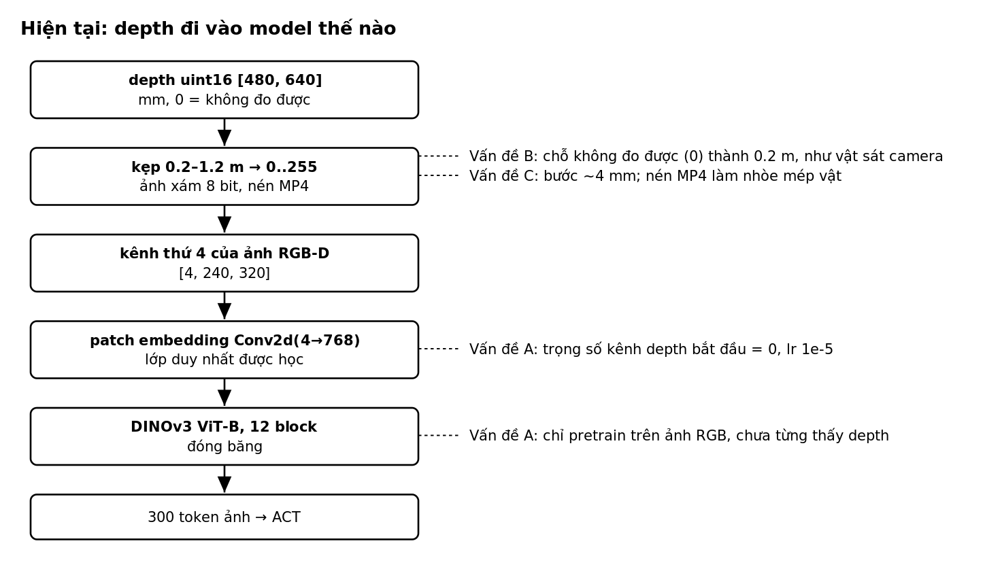
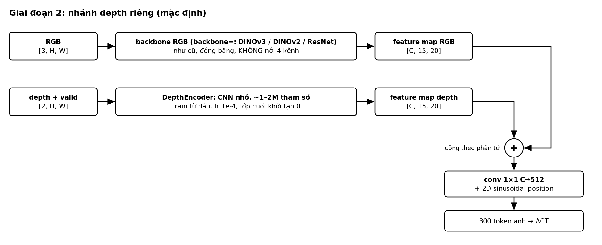
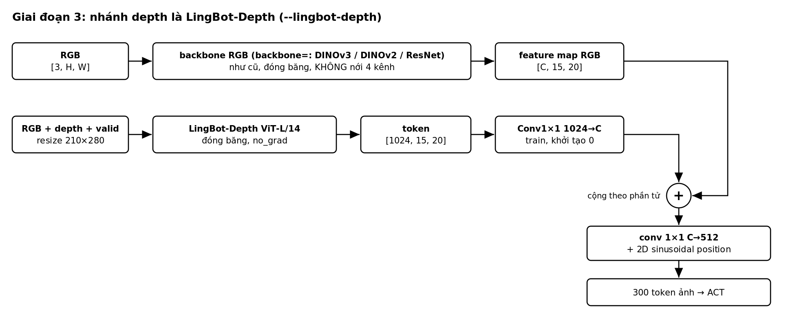
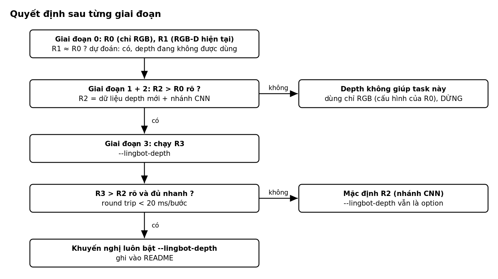

# Implementation plan: xử lý depth cho ACT

Mục tiêu: đưa depth vào model **sao cho model thực sự dùng được nó**, đo bằng
số xem depth có giúp không, và chỉ đầu tư vào LingBot-Depth khi đã chứng minh
được depth có ích.

> **Trạng thái (12/10/2026):** code của Giai đoạn 1, 2, 3 và distill (mục 5b)
> đã xong, có test (108 test qua trên CPU) và đã chạy thử với trọng số thật
> trên 2 episode thật. Còn lại: các run trên GPU (R0–R4), đo tốc độ
> LingBot-Depth trên GPU (3.1). Kiến trúc sau khi triển khai:
> [images/architecture_depth.png](images/architecture_depth.png).

Thứ tự làm: **Giai đoạn 0 (đo) → 1 (dữ liệu) → 2 (nhánh depth) → 3 (LingBot-Depth)**.
Mỗi giai đoạn kết thúc bằng một quyết định đi tiếp hay dừng (mục 6).

Kết quả cuối cùng, nhìn từ người dùng:

```bash
scripts/run_pipeline.sh exp_name=v1 --depth-branch          # nhánh depth CNN nhỏ (giai đoạn 2)
scripts/run_pipeline.sh exp_name=v1 --lingbot-depth         # nhánh depth là LingBot-Depth (giai đoạn 3)
scripts/run_pipeline.sh exp_name=v1 --lingbot-depth-distill # LingBot-Depth chỉ làm thầy lúc train (mục 5b)
scripts/run_pipeline.sh exp_name=v1 --resnet --lingbot-depth   # kết hợp với cờ backbone: --resnet, --dinov2, --dinov3
```

---

## 1. Bối cảnh: vì sao phải sửa

Hiện tại depth đi vào model như sau:



| # | Vấn đề | Ở đâu trong code | Hậu quả |
|---|---|---|---|
| A | Depth chỉ đi qua **một lớp được học**, khởi tạo 0, lr nhỏ; ViT phía sau đóng băng, không hiểu depth | `backbones.py` (`Backbone.configure`), `conf/finetune/frozen.yaml` | model có thể thực chất **chỉ dùng RGB** mà không ai biết |
| B | `depth = 0` (không đo được) bị kẹp về 0.2 m thành giá trị 0 | `images.py` (`depth_to_image`), `modeling_openarm_act.py` (`prepare_images`) | lỗ depth trông như **vật sát camera** |
| C | Lưu 8 bit (bước ~4 mm) + nén MP4 | `images.py`, `convert.py` (`features`) | mất chi tiết, **nhòe mép vật** |

---

## 2. Giai đoạn 0: đo hiện trạng (R0, R1)

Không đổi code model. Mục đích: có mốc so sánh, và kiểm tra vấn đề A có thật không.

- **R0**: chỉ RGB. Train lại trong repo này; không dùng R0 người khác đã
  train, vì cấu hình không khớp và kết quả inference không tốt.
- **R1**: RGB-D như repo đang làm (depth là kênh thứ 4).

Hai run chỉ khác nhau ở việc có depth hay không. Mọi thứ khác phải giống nhau:
dataset, **tập val**, nhãn, backbone, số bước, batch size, lr, seed.

### Việc cần làm

- [x] **0.1 Script `scripts/inspect_checkpoint.py checkpoint=...`:** đọc
  `model.safetensors`, in chuẩn L2 của trọng số lớp đầu theo từng kênh đầu
  vào (R, G, B, depth) và tỉ lệ `‖depth‖ / mean(‖RGB‖)`. Với ResNet đọc
  `model.backbone.body.conv1.weight`, với ViT đọc lớp patch embedding (dùng
  `Backbone.first_conv()`).
- [ ] **0.2 Train R0 và R1** trên GPU (cùng seed, cùng số bước):

| Run | Lệnh |
|---|---|
| R0 | `scripts/run_pipeline.sh exp_name=r0_rgb data=openarm_rgb data.action_source=qpos data.val_fraction=0.15` |
| R1 | `scripts/run_pipeline.sh exp_name=r1_rgbd` |

  Hai override của R0 là bắt buộc: preset `openarm_rgb` mặc định dùng nhãn
  `commands` và không giữ tập val (`val_fraction: 0.0`). Thiếu chúng thì R0
  học nhãn khác và train cả trên các episode dùng để đánh giá.
- [ ] **0.3 Kiểm tra hai run cùng tập val:** so danh sách episode
  `split val` trong `openarm_conversion.json` của hai dataset
  (`data/lerobot/openarm/openarm_rgb_qpos_50hz/` và `.../openarm_rgbd_qpos_50hz/`).
  Danh sách có thể lệch nếu có episode thiếu depth, vì R1 bỏ các episode đó
  còn R0 thì không.
- [ ] **0.4 Đánh giá:** `offline_eval.py` cho cả hai; chạy 0.1 cho R1.

### Hoàn thành khi

- Có bảng arm RMSE / gripper MAE của R0, R1 và baseline `hold`, trên cùng tập val.
- Biết tỉ lệ trọng số depth/RGB của R1. Dự đoán: rất nhỏ, tức vấn đề A có thật.
- Báo cáo theo mẫu [REPORT_TEMPLATE.md](REPORT_TEMPLATE.md): phần A (offline) và phần B (robot).

---

## 3. Giai đoạn 1: dữ liệu depth không mất thông tin, có mask

Sửa vấn đề B và C. Cần làm dù sau đó chọn hướng nào.

### Thiết kế

LeRobot 0.6.1 đã có **kiểu feature depth riêng**: feature có
`info.is_depth_map = true` được mã hoá thành video HEVC 12 bit **không mất
mát** (lượng tử hoá log 12 bit), và lúc đọc được giải mã lại thành mét hoặc
mm (`DepthEncoderConfig`, `dequantize_depth`). Dùng kiểu này thay cho ảnh xám
8 bit:

- Lưu depth thô (uint16 mm) vào feature `observation.images.chest_depth` với
  `is_depth_map: true`.
- Ở model, sinh **mask hợp lệ** từ depth đã giải mã: `valid = (d > 0) & isfinite(d)`.
  Chỗ không hợp lệ được gán giá trị trung tính sau chuẩn hoá (0) chứ không
  phải 0.2 m.
- Chuẩn hoá depth trong model: `d_norm = clip((d - 0.2) / 1.0, 0, 1)` trên
  điểm hợp lệ (cùng khoảng 0.2–1.2 m), rồi `(d_norm - 0.5) / 0.25` để cùng cỡ
  với RGB đã chuẩn hoá ImageNet.

### Việc cần làm

- [x] **1.1 Kiểm tra trước (nửa giờ):** *Kết quả: sai số < 1 mm trong
  0.2–1.2 m; giá trị 0 đọc lại thành 0.01 m (giới hạn dưới của bộ lượng tử),
  nên ngưỡng `depth_valid_min_m = 0.1` tách được điểm thiếu, không cần feature
  mask riêng. Chế độ ảnh (`data.video=false`) giữ chính xác tuyệt đối.* viết một test nhỏ ghi rồi đọc lại
  một frame depth qua `LeRobotDataset` với `is_depth_map`. Xác nhận: (a) sai
  số giải mã trong khoảng 0.2–1.2 m, (b) **giá trị 0 được giữ là 0** (hoặc
  nhận ra được) sau khi lượng tử hoá log, (c) backend `pyav` đọc được (LeRobot
  chỉ giải mã depth bằng pyav). Nếu (b) không đạt thì lưu thêm một feature
  mask riêng dạng ảnh.
- [x] **1.2 `conf/data/`:** thêm `depth_format: gray8 | raw`
  (`gray8` = như hiện tại, giữ để so sánh) và dataset mới
  `conf/data/openarm_rgbd_raw.yaml` (`depth_format: raw`). `repo_id` khác nên
  dataset cũ không bị ghi đè.
- [x] **1.3 `convert.py`:** `features()` khai báo `chest_depth` với
  `shape (H, W, 1)` và `info: {is_depth_map: true}` khi `depth_format=raw`;
  vòng lặp ghi frame đưa thẳng `episode.depth(index)` (uint16) vào. Thêm
  `depth_format` vào `CONVERSION_KEYS` để dataset cũ không bị dùng lại nhầm.
- [x] **1.4 `images.py`:** thêm `depth_to_metres(depth_mm) -> float32 [1, H, W]`
  cho đường serve, khớp từng giá trị với cách LeRobot giải mã lúc train.
- [x] **1.5 `policy.py`:** khi `depth_format=raw`, đưa depth của client vào
  batch theo `depth_to_metres` thay cho `to_model_input`.
- [x] **1.6 `modeling_openarm_act.py` (`prepare_images`):** đọc depth theo mét,
  tính `valid`, chuẩn hoá như trên, gán 0 ở chỗ không hợp lệ. Thêm
  `depth_format` vào `OpenArmACTConfig` để checkpoint tự biết cách đọc.
- [x] **1.7 `train_config.py`:** dataset depth thô cần `video_backend=pyav`
  cho feature depth. Kiểm tra `DatasetConfig.depth_output_unit = "m"`.

### Test

- [x] Convert episode giả rồi đọc lại: depth sau giải mã khớp HDF5 trong sai số
  lượng tử (dự kiến dưới 1 mm ở 1 m), pixel 0 vẫn là không hợp lệ.
- [x] `policy.infer` với depth thô từ client cho kết quả **giống hệt** batch
  lấy từ dataset (train và serve không lệch nhau).
- [x] Ảnh depth có lỗ: chỗ lỗ ra 0 sau chuẩn hoá, không phải giá trị "gần".
- [x] Toàn bộ test cũ vẫn qua (`depth_format=gray8` không đổi hành vi).

### Hoàn thành khi

Convert được 85 episode thật với `data=openarm_rgbd_raw`, biết dung lượng
dataset mới, và các test trên đều qua.

---

## 4. Giai đoạn 2: nhánh depth riêng

Sửa vấn đề A: depth có encoder riêng, được học đầy đủ.

### Thiết kế



- `DepthEncoder`: 4–5 tầng `Conv3×3 stride 2 + GroupNorm + ReLU`, kênh
  32→64→128→256, rồi `AdaptiveAvgPool2d` về đúng lưới token của backbone RGB
  (15×20) và `Conv1×1 → C` (C = số chiều token RGB: 768 cho ViT-B). Tầng cuối
  khởi tạo 0, để lúc đầu model y như RGB-only và depth được "thêm dần vào".
  Khoảng 1–2M tham số.
- Ghép: `feature_map = rgb_map + depth_map` (cộng, giữ nguyên 300 token và
  chi phí encoder ACT). Phương án dự phòng: nối kênh rồi conv 1×1.
- `DepthEncoder` học với lr của ACT (1e-4), không phải `lr_backbone` (1e-5):
  nó train từ đầu, không có gì pretrain để giữ.

### Việc cần làm

- [x] **2.1 `configuration_openarm_act.py`:** `depth_as` thêm giá trị
  `"branch"`; thêm `depth_encoder: str = "cnn"` (giai đoạn 3 thêm
  `"lingbot_depth"`) và `depth_encoder_channels: tuple = (32, 64, 128, 256)`.
  `image_features` bỏ depth_key khi `depth_as` là `channel` hoặc `branch`.
  `image_channels` = 3 khi `branch`.
  Hydra: nhóm mới `conf/depth_encoder/cnn.yaml` (mặc định), để giai đoạn 3 chỉ
  cần thêm một file cùng nhóm.
- [x] **2.2 `backbones.py`:** class `DepthEncoder(nn.Module)`:
  `forward(depth [B,2,H,W], grid (h, w)) -> [B, C, h, w]`.
- [x] **2.3 `backbones.py` + `modeling_openarm_act.py`:** module
  `RGBDFusion(Backbone)` gồm `self.rgb` (backbone RGB như cũ) và `self.depth`
  (`DepthEncoder`), gắn vào chỗ `self.model.backbone`, nên `ACT.forward` của
  LeRobot không phải sửa. Nó nhận một tensor 5 kênh
  `[rgb(3) | depth(1) | valid(1)]`, tách ra, chạy hai nhánh, cộng hai feature
  map. `prepare_images` tạo tensor 5 kênh đó (chỉ resize, chuẩn hoá phần RGB).
- [x] **2.4 `get_optim_params`:** LeRobot chia nhóm theo tiền tố
  `model.backbone`, nên `model.backbone.depth.*` sẽ rơi vào nhóm lr 1e-5.
  Override để đưa chúng về nhóm chính (lr 1e-4); có test kiểm tra.
- [x] **2.5 `conf/data/openarm_rgbd_branch.yaml`:** `depth_format: raw`,
  `depth_as: branch`; đổi thành mặc định nếu R2 thắng.
- [x] **2.6 Sơ đồ:** cập nhật `docs/images/architecture.svg` và `DESIGN.md`.

### Test

- [x] Shape: feature map ghép bằng shape của RGB cho cả 3 họ backbone.
- [x] Khởi tạo: output **bằng hệt** model RGB-only khi tầng cuối DepthEncoder = 0.
- [x] Sau khi chỉnh trọng số DepthEncoder: đổi depth thì output đổi.
- [x] Nhóm optimizer: DepthEncoder ở lr 1e-4, backbone RGB đóng băng hoàn toàn (không còn nới 4 kênh).
- [x] Train 4 bước trên CPU rồi resume, lưu/nạp checkpoint strict, export, serve offline.

### Hoàn thành khi

Có run **R2** (`data=openarm_rgbd_branch`) train xong trên GPU và offline eval
cùng tập val với R0, R1. Tốc độ suy luận không tăng đáng kể so với R0.

---

## 5. Giai đoạn 3: option `--lingbot-depth`

LingBot-Depth trở thành một **option truyền vào script train**. Nó thay CNN
nhỏ trong nhánh depth của giai đoạn 2; backbone RGB vẫn chọn bằng `backbone=`
như cũ. Không truyền cờ thì mọi thứ như giai đoạn 2.

### LingBot-Depth là gì

[`robbyant/lingbot-depth-pretrain-vitl-14`](https://huggingface.co/robbyant/lingbot-depth-pretrain-vitl-14):
ViT-L/14 (~300M tham số) pretrain để đọc **RGB và depth thô cùng lúc** và
hoàn thiện depth (điền lỗ, khử nhiễu). openarm_lingbot dùng nó làm teacher
(`conf/model/lingbot_v1_depth.yaml`, file `model.pt`).

### Thiết kế



- LingBot-Depth **đóng băng** và chạy dưới `no_grad`: chỉ lớp Conv1×1 nối vào
  được train (lr 1e-4), khởi tạo 0 như CNN của giai đoạn 2.
- Kích thước ảnh vào LingBot-Depth chọn sao cho lưới token khớp lưới của
  backbone RGB (patch 14: 210×280 → 15×20).
- Checkpoint chứa cả trọng số LingBot-Depth, nên serve không cần Hub (như DINOv3).

### Giao diện dòng lệnh

Các script dùng Hydra (`key=value`), và Hydra từ chối tham số `--...` lạ. Vì
vậy cờ được **đổi thành override Hydra trước khi Hydra đọc `sys.argv`**:

| Gõ | Thành |
|---|---|
| `--lingbot-depth` | `depth_encoder=lingbot_depth` + `data=openarm_rgbd_branch` (chỉ khi chưa có `data=` nào trên dòng lệnh) |

- Dạng Hydra `depth_encoder=lingbot_depth` vẫn dùng được, kết quả như nhau.
- Tên run tự thêm hậu tố: `checkpoints/act_<backbone>_<finetune>_lingbotdepth/<exp_name>/`,
  nên run có và không có cờ không ghi đè nhau.
- `offline_eval.py`, `export_policy.py`, `serve.py` **không cần cờ**: chúng
  đọc cấu hình từ checkpoint.
- Cờ `--...` không biết → báo lỗi, liệt kê các cờ có sẵn (không lặng lẽ bỏ qua).

### Việc cần làm

- [ ] **3.1 Khảo sát (trước khi code):** *Đã đọc code và giấy phép (Apache 2.0),
  đã kiểm bản chép giống hệt code gốc. Tốc độ: trên CPU ~5 s/chunk; **trên GPU chưa đo**
  (đo bằng `scripts/smoke_train.sh --lingbot-depth`, xem `server_ms`).*
  - Đọc code của nó (trong `third_party/lingbot-vla` của openarm_lingbot, hoặc
    repo gốc): input chính xác (kích thước, chuẩn hoá RGB, đơn vị depth, cách
    đánh dấu chỗ thiếu), output nào là token đặc trưng, cách nạp `model.pt`.
  - Giấy phép: có cho dùng làm encoder trong policy và phân phối checkpoint không.
  - Đo tốc độ một forward ở lưới 15×20, batch 1, trên GPU server. Ghi số đo
    vào README: nếu round trip (server + mạng) vượt **20 ms/bước** thì robot
    phải hỏi thưa hơn (`query_period` > 1).
- [x] **3.2 `backbones.py`:** `LingBotDepthEncoder(nn.Module)`, cùng giao
  diện với `DepthEncoder` của giai đoạn 2:
  `forward(rgb, depth, valid, grid) -> [B, C, h, w]`; nạp trọng số từ Hub theo
  revision ghim. Vendor phần code mô hình tối thiểu (kèm license), không phụ
  thuộc cả repo LingBot.
- [x] **3.3 `conf/depth_encoder/lingbot_depth.yaml`:** `name: lingbot_depth`,
  `suffix: _lingbotdepth`, `repo`, `revision`, kích thước ảnh vào.
  `conf/train.yaml`: `name: act_${backbone.name}_${finetune.name}${depth_encoder.suffix}`
  (`cnn.yaml` có `suffix: ""`).
- [x] **3.4 `src/openarm_act_lerobot/cli.py`:** `FLAGS = {"--lingbot-depth": [...]}`
  và `expand_flags(argv) -> argv`. Gọi `sys.argv = expand_flags(sys.argv)` ở đầu
  `scripts/train.py`, `train_pipeline.py`, `compute_norm_stats.py`,
  `convert_dataset.py`, trước `main()`.
- [x] **3.5 Script bash:** `run_pipeline.sh` đã chuyển `"$@"` sang Python nên
  tự có cờ. `smoke_train.sh`: đoạn Python tính thư mục checkpoint cũng gọi
  `expand_flags`. Thêm ví dụ `--lingbot-depth` vào phần chú thích đầu file.
- [x] **3.6 `run.py`:** `fetch_backbone` tải luôn LingBot-Depth khi cờ bật
  (bước "2/6 backbone" của pipeline), để lỗi tải xảy ra trước khi tải 30 GB episode.
- [x] **3.7 README:** mục Configuration thêm cờ, ví dụ, và số đo tốc độ.

### Test

- [x] `expand_flags`: có cờ → đúng override; đã có `data=` → không thêm
  `data=`; cờ lạ → lỗi; không có cờ → argv giữ nguyên.
- [x] Compose với `--lingbot-depth`: `cfg.name` có hậu tố, `depth_encoder.name == "lingbot_depth"`.
- [x] `LingBotDepthEncoder` với trọng số ngẫu nhiên (không tải): shape khớp lưới
  của cả 3 họ backbone RGB, đóng băng hoàn toàn, chỉ Conv1×1 trong nhóm optimizer.
- [x] Train 4 bước trên CPU rồi resume, lưu/nạp checkpoint strict, export,
  serve offline (`HF_HUB_OFFLINE=1`) với cờ bật.

### Hoàn thành khi

`scripts/smoke_train.sh --lingbot-depth` chạy hết 6 bước trên GPU; có run
**R3** (`--lingbot-depth`) và số đo tốc độ; quyết định mặc định theo mục 6.

---

## 5b. Option `--lingbot-depth-distill` (thêm theo yêu cầu)

LingBot-Depth làm **thầy chỉ lúc train**; robot và server chạy như không có nó.

- Học sinh: token ảnh ở **đầu ra encoder Transformer của ACT** (300 × 512),
  qua `distill_head` (LayerNorm + Linear 512→1024), dự đoán đặc trưng của
  LingBot-Depth cho cùng patch (đọc RGB + depth thô, lưới 15×20).
- Loss: `loss = L1 + 10·KL + distill.weight · (1 − cos)`, `distill.weight = 0.1`.
  Distill tác động vào encoder ACT (được train), nên có tác dụng cả khi backbone RGB đóng băng.
- Thầy được tạo lần đầu khi train, nằm ngoài cây module: không vào checkpoint,
  không vào optimizer, không chạy lúc suy luận hay lúc eval.
- Học sinh có nhánh depth CNN (mặc định của cờ), hoặc chỉ RGB với
  `data.depth_as=none` (robot không cần camera depth lúc chạy).
- Không dùng cùng `--lingbot-depth` (LingBot-Depth đã là encoder thì distill vào chính nó không thêm gì).

- [x] `distill_head`, hook lấy đầu ra encoder, `distill_loss` (`modeling_openarm_act.py`)
- [x] `conf/distill/{none,lingbot_depth}.yaml`, cờ `--lingbot-depth-distill`, hậu tố `_distill` trong tên run
- [x] Test: loss có mặt lúc train, gradient tới encoder ACT nhưng không tới thầy,
  thầy không trong `state_dict`, suy luận và eval không tạo thầy; train → resume → export → serve
- [x] Chạy thật: DINOv2-S + LingBot-Depth thật, 2 episode thật, loss distill giảm 1.03 → 0.96 sau 4 bước (CPU)

---

## 6. Thí nghiệm và quyết định

| Run | Dữ liệu | Depth vào mạng | Giai đoạn |
|---|---|---|---|
| R0 | (không dùng depth) | không (chỉ RGB) | 0 |
| R1 | gray8 | kênh thứ 4 (hiện tại) | 0 |
| R2 | raw + mask | nhánh `DepthEncoder` | 1 + 2 |
| R3 | raw + mask | nhánh LingBot-Depth (`--lingbot-depth`) | 3 |
| R4 | raw + mask | nhánh CNN + thầy LingBot-Depth lúc train (`--lingbot-depth-distill`) | 5b |

Giữ cố định: backbone RGB (DINOv3 ViT-B/16, hoặc `dinov2_vitb14` khi chưa có
quyền DINOv3), `num_train_steps`, `batch_size=32`, seed, tập val. Nên chạy 2
seed mỗi cấu hình vì dữ liệu ít (85 episode, một task).



"Rõ" nghĩa là: arm RMSE giảm hơn mức chênh giữa 2 seed của cùng cấu hình,
**và** tỉ lệ thành công trên robot (20 lần mỗi model) không kém hơn.

## 7. Ước lượng công sức

| Giai đoạn | Code + test | GPU |
|---|---|---|
| 0 | ~1 giờ (script 0.1) | 2 run R0, R1 (×2 seed nếu được) |
| 1 | ~0.5–1 ngày | convert lại 85 episode |
| 2 | ~1 ngày | 1 run (×2 seed) |
| 3 | khảo sát 0.5 ngày, tích hợp 1–2 ngày, cờ `--lingbot-depth` ~2 giờ | 1 run + đo tốc độ |

## 8. Rủi ro

| Rủi ro | Cách xử lý |
|---|---|
| Lượng tử hoá log của LeRobot không giữ được giá trị 0 | 1.1 kiểm tra trước; nếu không giữ được thì lưu mask thành feature riêng |
| Giải mã depth chỉ chạy bằng pyav, chậm hơn torchcodec | đo `data_s` trong log train; tăng `num_workers` |
| Dataset depth thô lớn hơn nhiều | đo ở 1.x; kiểm tra đĩa máy GPU trước khi convert cả 85 episode |
| Khác biệt giữa các run nằm trong nhiễu | 2 seed mỗi cấu hình; quyết định cuối dựa trên robot |
| LingBot-Depth quá chậm hoặc giấy phép không cho phép | cờ vẫn có nhưng ghi rõ giới hạn trong README; mặc định giữ R2 |

## 9. Cần bạn xác nhận trước khi bắt đầu

1. Máy GPU còn bao nhiêu đĩa trống?
2. Đã có quyền tải DINOv3 chưa? Chưa thì các run dùng `backbone=dinov2_vitb14`.
